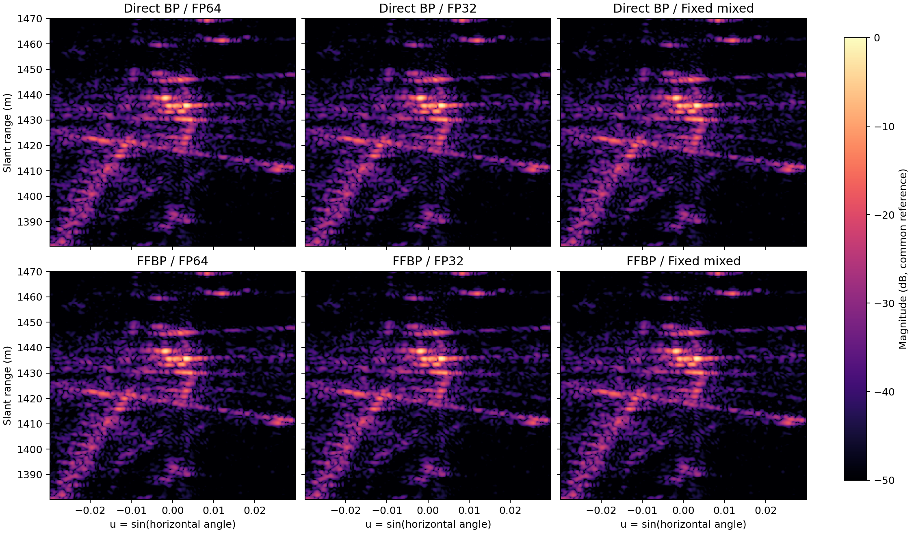
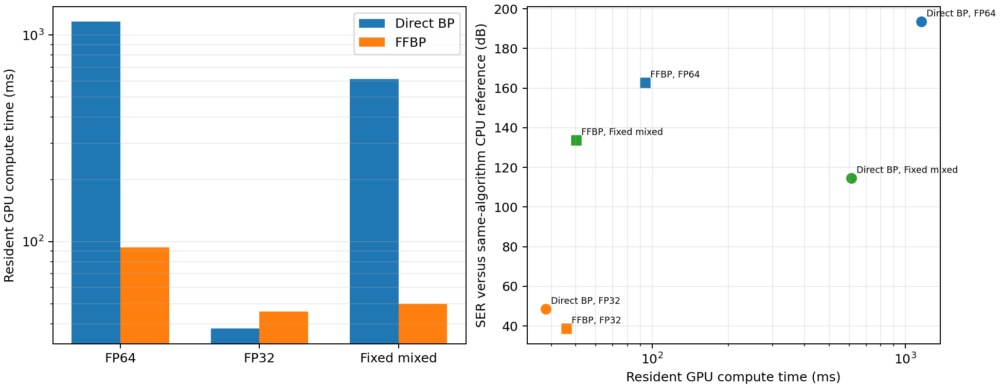
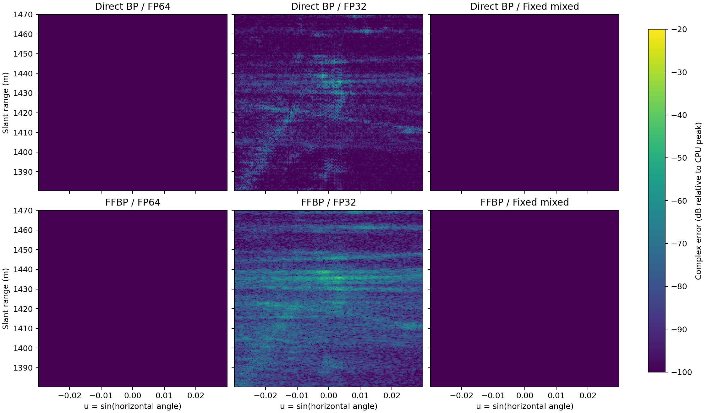

# GPU 直接 BP 与 FFBP 基线实验

实验日期：2026-09-16。真实回波、轨迹、窗函数和输出网格保持不变，仅改变 GPU 核函数的计算精度。结果表明，FP64 和固定混合精度均达到预设的移植误差门限；纯 FP32 直接 BP 达到 40 dB SER 目标，纯 FP32 FFBP 为 38.78 dB。

## 1. 数据与实验条件

| 项目 | 数值或来源 |
|---|---|
| 原始数据 | [`2018-08-14_18-54-08.dat`](../2018-08-14_18-54-08.dat)，1,073,741,824 B，SHA-256 `4DE4A32F...34B03E8` |
| 有效数据 | 12,757 脉冲，20,000 距离采样/脉冲；脉冲号 26781–39537，无缺号 |
| 雷达参数 | (f_c=1.4\) GHz，(B=200\) MHz，(T_p=1\) μs，(F_s=400\) MHz，PRF=1 kHz |
| 距离压缩 | [`range_compressed.npy`](results/range_compressed.npy)，`complex64 [12757, 20000]`，SHA-256 `1F3EB07B...9443EEE` |
| 轨迹 | [`autofocus_position.npy`](results/autofocus_position.npy)，SHA-256 `C836F296...B5603B6` |
| 成像约定 | 左视，平地 (z=0\)，Hann 方位窗，(k=-4\pi f_c/c=-58.6836606\) rad/m |
| 固定 ROI | (r=1380\text{–}1470\) m，(u=\sin\theta=-0.03\text{–}0.03\)；输出 360×365 |
| FFBP 参数 | 叶节点 64 脉冲，(\Delta r=0.25\) m，角向过采样 3；256 叶节点、255 次合并 |

帧审计和距离压缩参数见 [`capture_audit.json`](results/capture_audit.json) 与 [`range_compressed.json`](results/range_compressed.json)。最终网格由一份 FP64 节点计划生成：`r0=1380.25 m`，`u0=-0.0298358876`，`du=1.64112355×10⁻⁴`。三种精度共用相同的节点边界、保护单元和裁剪索引。

## 2. GPU 基线

CUDA C++ 内核位于 [`gpu/kernels.cu`](gpu/kernels.cu)，通过 CuPy RawModule 和 NVIDIA NVRTC 12.2 编译。主机调度见 [`gpu_backend.py`](gpu_backend.py)，完整实验脚本见 [`gpu_baseline.py`](gpu_baseline.py)。未启用 `--use_fast_math`。

| 模式 | 几何、距离、采样坐标及相位 | 插值与相干累加 | 输入及节点图 |
|---|---|---|---|
| FP64 | FP64 | FP64 | complex64 |
| FP32 | FP32 | FP32 | complex64 |
| 固定混合精度 | FP64 | FP32 | complex64 |

直接 BP 按 64 脉冲分块启动，以避开 Windows WDDM 看门狗；累加器贯穿全部分块，脉冲次序不变。FFBP 保留 CPU 实现的舍入点：叶节点和每次重采样先写入 complex64，左右子节点再作 complex64 加法。四点 Lagrange 插值使用 `floor(q)` 和 `i-1…i+2`，邻域越界时返回零。

硬件为 RTX 4070 Laptop GPU（Ada，SM 8.9，8 GB）和 Intel Core i9-14900HX。CUDA 驱动版本为 13.3，运行时为 12.9，CuPy 13.6.0。每项先执行 1 次全尺寸预热，再重复 5 次；GPU 驻留计算采用 CUDA event 计时。CPU 使用 16 线程，重复 3 次。

## 3. 成像结果



**图 1.** 同一极坐标 ROI 的成像结果。上行为直接 BP，下行为 FFBP；三列依次为 FP64、FP32和固定混合精度。横轴为 (u=\sin\theta\)，纵轴为斜距，六幅图采用共同幅度参考和 −50–0 dB 显示范围。该图是极坐标复图像的幅度显示，不是完整地面投影图。

三种精度的主要散射结构和峰值位置一致，肉眼差异很小。数值差异见表 2 和图 3。

### 3.1 计算时间

| 算法 | 精度 | GPU 驻留计算中位数 [Q1, Q3] / ms | CPU 中位数 / ms | 相对 CPU 加速 | 主机内存至结果 / ms |
|---|---:|---:|---:|---:|---:|
| 直接 BP | FP64 | 1158.554 [1158.295, 1158.901] | 10200.507 | 8.80× | 2176.355 |
| 直接 BP | FP32 | **38.050 [37.629, 38.082]** | 10200.507 | **268.08×** | 1055.681 |
| 直接 BP | 固定混合 | 611.359 [611.165, 611.543] | 10200.507 | 16.68× | 1628.993 |
| FFBP | FP64 | 93.853 [93.260, 93.925] | 538.205 | 5.73× | 1111.504 |
| FFBP | FP32 | **45.877 [40.502, 49.973]** | 538.205 | **11.73×** | 1063.489 |
| FFBP | 固定混合 | 50.085 [50.081, 50.653] | 538.205 | 10.75× | 1067.767 |

2.04 GB 输入从内存映射文件复制到普通主机内存耗时 1.112 s，随后 H2D 传输耗时 1.017 s。表中的“主机内存至结果”包含 H2D、GPU 计算和 D2H，不含文件装载。CuPy 内存池实测峰值为 1.904 GiB；CUDA 上下文及 WDDM 占用未计入该值。

在该 360×365 小 ROI 上，FP32 直接 BP 比 FP32 FFBP 快 1.21 倍。FFBP 虽将像素—脉冲乘积由 1.676×10⁹ 降至约 1.05×10⁸，但当前基线包含约 1022 次小核启动，FP32 时启动与中间图访存开销占主导。FP64 和固定混合精度下，FFBP 分别比对应直接 BP 快 12.34 倍和 12.21 倍。



**图 2.** 左：驻留 GPU 计算时间；右：相对同算法 CPU 参考的 SER—时间关系。FP32 获得最高速度，固定混合精度保留了接近 FP64 的复数保真度。

### 3.2 GPU 数值误差

表 2 的参考分别为 CPU 直接 BP 和 CPU FFBP，因此只衡量 GPU 移植与精度误差，不含 FFBP 的算法近似误差。相位标准差在 CPU 参考峰值以上 −30 dB 的像素内计算，并去除圆均值相位偏差。

| 算法 | 精度 | 相对复误差 | SER / dB | 复相干系数 | 相位标准差 / ° | 峰值幅度差 / dB |
|---|---:|---:|---:|---:|---:|---:|
| 直接 BP | FP64 | 2.13×10⁻¹⁰ | 193.42 | 1.000000 | 2.14×10⁻⁸ | 0.000000 |
| 直接 BP | FP32 | 3.685×10⁻³ | 48.67 | 0.999994 | 0.1974 | +0.00081 |
| 直接 BP | 固定混合 | 1.879×10⁻⁶ | 114.52 | 1.000000 | 6.21×10⁻⁵ | −0.000004 |
| FFBP | FP64 | 7.31×10⁻⁹ | 162.72 | 1.000000 | 3.09×10⁻⁷ | 0.000000 |
| FFBP | FP32 | 1.150×10⁻² | 38.78 | 0.999941 | 0.5593 | −0.02646 |
| FFBP | 固定混合 | 2.040×10⁻⁷ | 133.81 | 1.000000 | 8.66×10⁻⁶ | −0.000001 |

FP64 和固定混合精度分别满足 (\varepsilon\le10^{-4}\) 与 (\varepsilon\le10^{-3}\) 的预设门限。FP32 直接 BP 满足 (\varepsilon\le0.01\)；FP32 FFBP 的误差为 1.15%，未达到该工程目标。六组结果的峰值像素均为 `[222, 201]`，五次重复的逐次相对误差均为 0。



**图 3.** GPU 结果相对同算法 CPU 参考的逐像素复数误差，统一按 CPU 峰值归一化。FP64 与固定混合精度误差大多低于 −100 dB 显示下限，因此图面接近单色；FP32 FFBP 的误差在强散射区域累积更明显。

### 3.3 FFBP 算法误差

| 精度 | FFBP 相对直接 BP 的复误差 | SER / dB | 复相干系数 | 相位标准差 / ° | 峰值幅度差 / dB |
|---:|---:|---:|---:|---:|---:|
| FP64 | 0.032858 | 29.667 | 0.999833 | 0.9105 | −0.31365 |
| FP32 | 0.034647 | 29.207 | 0.999778 | 1.0480 | −0.34092 |
| 固定混合 | 0.032858 | 29.667 | 0.999833 | 0.9105 | −0.31365 |

约 3.29% 的 FP64/固定混合误差来自 FFBP 分解与重采样近似。纯 FP32 又引入约 1.15% 的同算法数值误差，使总误差升至 3.46%。

## 4. 结论

1. CUDA 移植保持了现有 CPU 成像定义。FP64 误差低于 (10^{-8})，固定混合精度低于 (2×10^{-6})，可作为后续优化的正确性基线。
2. 固定混合精度是当前稳妥方案：直接 BP 和 FFBP 的 SER 分别为 114.52 dB 和 133.81 dB；驻留计算相对 CPU 分别加速 16.68 倍和 10.75 倍。
3. 纯 FP32 直接 BP 适合追求吞吐的场景；FP32 FFBP 未达到 40 dB SER 目标，后续应研究分解树分层精度，而不是整棵树统一降为 FP32。
4. 当前 FFBP 由大量小核组成。下一阶段的性能优化应合并左右重采样与相加、按层批处理节点，并保持本报告的舍入顺序基线作为对照。

真实场景中没有已标定角反射器或地面真值。本报告评价的是复数一致性、相位保真度和计算性能；IRW、PSLR、ISLR 等分辨率指标应在独立点目标仿真或标定场数据上报告。

## 5. 复现文件

- 原始指标：[`metrics.json`](results/gpu_baseline/metrics.json)
- 算子验证：[`operator_validation.json`](results/gpu_baseline/operator_validation.json)
- CPU/GPU 复数图像与坐标：[`results/gpu_baseline/`](results/gpu_baseline/)
- GPU 环境说明：[`gpu/README.md`](gpu/README.md)

```powershell
D:\develop\Anaconda\python.exe fast_bp\gpu_baseline.py --repeats 5 --warmups 1 --cpu-repeats 3 --chunk-pulses 64
```

## 参考文献

1. Ulander, L. M. H., Hellsten, H., Stenström, G. *Synthetic-aperture radar processing using fast factorized back-projection*. IEEE Transactions on Aerospace and Electronic Systems, 2003, 39(3): 760–776. [DOI: 10.1109/TAES.2003.1238734](https://doi.org/10.1109/TAES.2003.1238734).
2. Góes, J. A. et al. *Fast Backprojection for Synthetic Aperture Radar*. Sensors, 2021, 21(15): 5099. [DOI: 10.3390/s21155099](https://doi.org/10.3390/s21155099).
3. Xu, W. et al. *The Adaptive Streaming SAR Back-Projection Algorithm Based on Half-Precision in GPU*. Electronics, 2022, 11: 2807. [DOI: 10.3390/electronics11182807](https://doi.org/10.3390/electronics11182807).
4. Gocho, M. et al. *Mixed-Precision Backprojection Using FP32 and FP64 for Boosting Satellite SAR Imaging on Embedded GPUs*. MCSoC 2025: 614–621. [DOI: 10.1109/MCSoC67473.2025.00101](https://doi.org/10.1109/MCSoC67473.2025.00101).
5. NVIDIA. *CUDA C++ Best Practices Guide*. [官方文档](https://docs.nvidia.com/cuda/cuda-c-best-practices-guide/).
6. Benson, T. *GOTCHA-Back: CUDA backprojection implementation and SER comparison*. [GitHub](https://github.com/tbensonatl/gotcha-back).
7. CuPy. *RawModule API Reference*. [官方文档](https://docs.cupy.dev/en/stable/reference/generated/cupy.RawModule.html).
