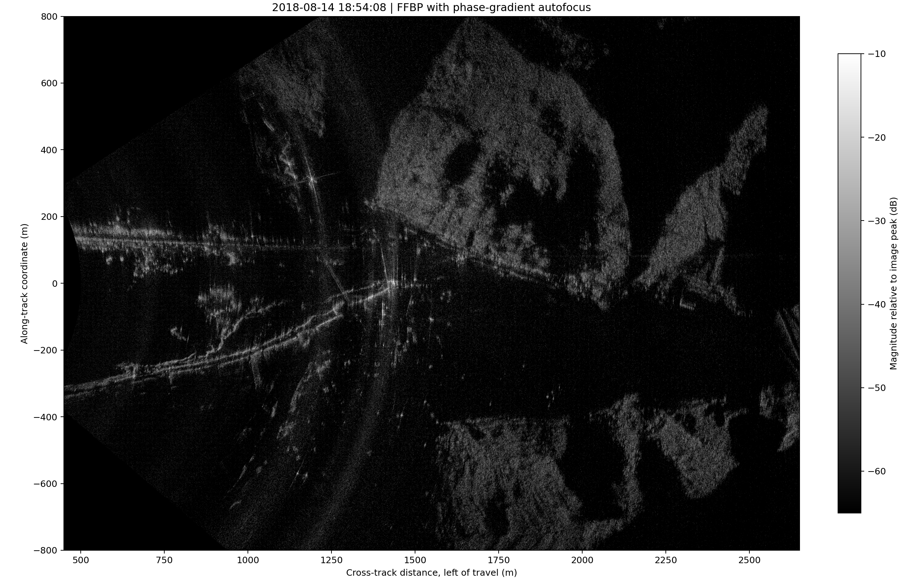
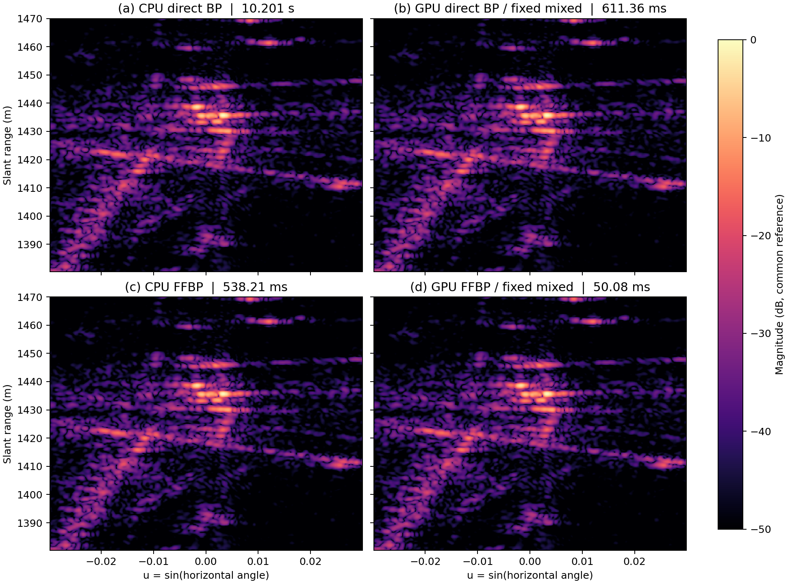
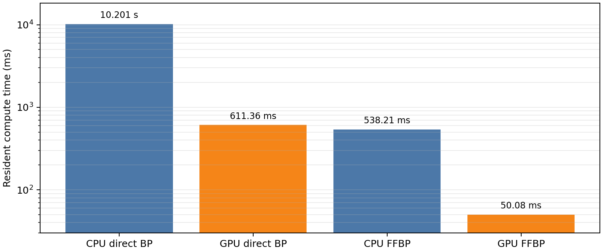

# BP算法在cpu和gpu上的成像效果对比

### 算法来源

| 算法 | 出处与本实验实现 |
|---|---|
| BP | SAR 层析反投影基础见 [1]；直接时域 BP 形式见 McCorkle [2]。逐像素计算双程距离，对距离压缩回波插值，完成相位补偿与孔径相干累加。 |
| FFBP | FFBP 方法见 Ulander、Hellsten 和 Stenström [3]。孔径递归分组，在局部极坐标网格形成子图，经重采样后逐层合并，以插值近似降低计算量。 |

## 2. 全场成像与四种基线

### 2.1 自聚焦后 FFBP 全场景地面图

​                                                                             图 1 `2018-08-14_18-54-08.dat` 的 FFBP/PGA 自聚焦地面成像结果

横向显示范围为 450–2650 m，航向范围为 −800–800 m，幅度窗为 −65 至 −10 dB。该图对应全场景FFBP结果，不作为四种CPU/GPU基线的同网格定量对照。

### 2.2 CPU/GPU 四种基线

| 实验 | 驻留计算时间 | 数值参考 | 相对复误差 | SER / dB | 峰值像素 |
|---|---:|---|---:|---:|---:|
| CPU 直接 BP | 10,200.507 ms | 高精度基准 | — | — | [222, 201] |
| GPU 直接 BP（固定混合） | 611.359 ms | CPU 直接 BP | $1.879\times10^{-6}$ | 114.52 | [222, 201] |
| CPU FFBP | 538.205 ms | CPU 直接 BP | 3.2858% | 29.67 | [222, 201] |
| GPU FFBP（固定混合） | 50.085 ms | CPU FFBP | $2.040\times10^{-7}$ | 133.81 | [222, 201] |

​	GPU 相对 CPU 的同算法加速比分别为 **16.68×**（直接 BP）和 **10.75×**（FFBP）。同一设备上，FFBP 相对直接 BP 的加速比为 **18.95×**（CPU）和 **12.21×**（GPU）。GPU FFBP 相对 CPU 直接 BP 达到 203.66×，但其相对 CPU 直接 BP 的总 SER 为 29.67 dB，因此该倍率不属于等质量加速。

​                                                                                                     图 2 同一实测 ROI 的四种成像结果

​	上行为直接 BP，下行为 FFBP；左列为 CPU，右列为固定混合精度 GPU。四幅图以 CPU 直接 BP 峰值为共同参考，显示范围均为 −50–0 dB。图中为极坐标复图像的幅度，不是地面投影图。

​	GPU 直接 BP 与 GPU FFBP 对各自 CPU 参考的误差均低于 $2\times10^{-6}$，说明 CUDA 实现保持了既定成像算子。CPU FFBP 相对 CPU 直接 BP 的 3.29% 复误差则反映因子分解和局部网格重采样的算法近似。

图 3. CPU/GPU 直接 BP 与 FFBP 的驻留计算时间（对数纵轴）。GPU 结果采用固定混合精度，计时不含文件读取及 H2D/D2H 传输。

​	固定混合精度 GPU 复现了同算法 CPU 结果：直接 BP 和 FFBP 的驻留计算时间分别由 10.201 s、538.205 ms 降至 611.359 ms、50.085 ms。FFBP 的主要误差来自分解与重采样近似，而非 GPU 移植。

​	若计入单次 H2D 和 D2H，GPU 直接 BP 为 1628.993 ms，仍比 CPU 快 6.26×；GPU FFBP 为 1067.767 ms，慢于 CPU FFBP 的 538.205 ms。纯 FP32 的直接 BP 为 38.050 ms / 48.67 dB，FFBP 为 45.877 ms / 38.78 dB。

​	本轮评价对象为计算时间和复数一致性。当前实测场景没有已标定点目标，空间分辨率、IRW、PSLR 与 ISLR 留待点目标实验测量。

## 3. 结论

1. 两种 GPU 实现均通过同算法 CPU 复图核对，峰值位置一致，固定混合精度可作为后续优化的正确性基线。
2. 数据常驻条件下，GPU 对直接 BP 和 FFBP 分别加速 16.68× 和 10.75×；四种配置中 GPU FFBP 用时最短。
3. 当前质量差异主要由 FFBP 的分解与重采样决定。后续比较应在相同输出网格和相同误差约束下进行。

## 4. 接下来的工作

​	下一步考虑用 Nsight Systems 分析按层批处理 FFBP 的耗时，查明时间主要花在叶节点 BP、重采样还是核函数调度上。在相同输出网格下调整叶节点大小、内部采样密度和各层计算精度，比较 SER 不低于 45 dB 时的计算速度。成像质量还需结合亮目标相位误差及点目标 IRW、PSLR、ISLR 判断。实验先使用现有实测数据和点目标仿真，再补充 GOTCHA 数据及其他型号 GPU 的对照实验。

## 参考文献

1. Munson, D. C., O'Brien, J. D., Jenkins, W. K. A Tomographic Formulation of Spotlight-Mode Synthetic Aperture Radar. *Proceedings of the IEEE*, 1983, 71(8): 917–925. 
2. McCorkle, J. W. Focusing of Synthetic Aperture Ultra Wideband Data. *IEEE International Conference on Systems Engineering*, 1991: 1–5. 
3. Ulander, L. M. H., Hellsten, H., Stenström, G. Synthetic-Aperture Radar Processing Using Fast Factorized Back-Projection. *IEEE Transactions on Aerospace and Electronic Systems*, 2003, 39(3): 760–776. 
4. Fasih, A., Hartley, T. GPU-Accelerated Synthetic Aperture Radar Backprojection in CUDA. *IEEE Radar Conference*, 2010.
5. NVIDIA. *MatX SAR Back Projection API* . <https://nvidia.github.io/MatX/api/signalimage/radar/sar_bp.html>.
6. Benson, T. *GOTCHA-Back: CUDA Backprojection Implementation and SER Comparison*. <https://github.com/tbensonatl/gotcha-back>.
